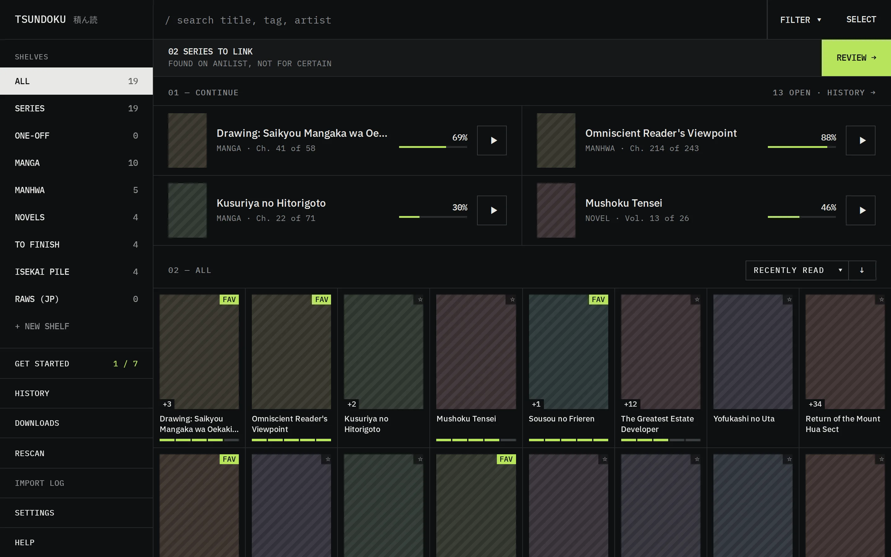
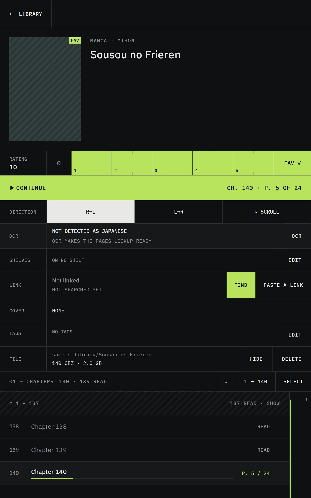
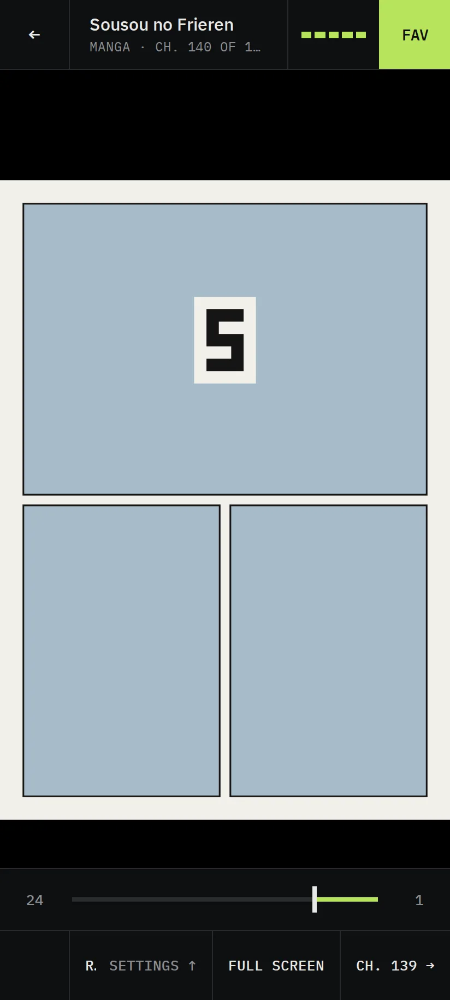

# tsundoku

積ん読 (_tsundoku_): buying books and letting them pile up unread.

A self-hosted library for everything one household reads and watches: manga,
manhwa, doujinshi, light and web novels, anime, films and shows. It runs on one
computer, keeps the files there, and serves them to the phones, tablets and TV
in the house, which read it in the browser, as an installed PWA, or in its
Android app.

| Library (desktop)                                                    | Series (tablet)                                                | Reader (phone)                                                 |
| -------------------------------------------------------------------- | -------------------------------------------------------------- | -------------------------------------------------------------- |
|  |  |  |

## What it does

- **Reads comics and novels.** Pages right to left, left to right, or one long
  strip; a text reader for EPUBs and web novels, vertical Japanese included.
- **Plays video.** Anime episodes, films and shows, streamed or downloaded, with
  openings and endings skipped.
- **Imports what you have.** Mihon backups and download folders, Hentoid
  libraries, EPUBs. Categories arrive as plain tags you can rename or delete.
- **Downloads through extensions.** Mihon, Aniyomi and LNReader extensions run
  in a separate engine ([tsundoku-engine](https://github.com/masshirodev/tsundoku-engine)).
  tsundoku ships no sources and names no repositories: you add your own.
- **Tracks progress everywhere.** Where you stopped, on every device; history
  by day, ratings out of 10, favourites; links to AniList, MyAnimeList and TMDB.
- **Works offline.** Chapters and episodes kept on a device read without the
  computer, and the reading done meanwhile is sent when it is back.
- **Keeps some shelves hidden.** Hidden series are filtered out on the server,
  and showing them can be put behind the device's fingerprint.
- **Helps with Japanese.** Raw pages can be OCR'd with mokuro, and tapping a
  word looks it up through [kotoba](https://github.com/masshirodev/kotoba).

## Who it is for

One household on one computer. It is not a multi-user server: there is one
library, one person's reading state, and a sign-in that keeps other people on
the network out. It is built for my own use and shared with friends, who
install the released bundles. Expect it to follow my needs rather than a
roadmap.

## Installing it

Released builds for Windows, Linux, Android and Android TV are on
[tsundoku.masshiro.pro](https://tsundoku.masshiro.pro). The Windows and Linux
bundles carry everything, the engine and its Java runtime included; the
Android apps pair with the computer over Wi-Fi. macOS is not built.

## Running from source

You need Node 24, Yarn 1 (`yarn@1.22.22`), and
[kotoba](https://github.com/masshirodev/kotoba) checked out beside this
repository, since `package.json` links it as `../kotoba`:

```sh
git clone https://github.com/masshirodev/kotoba
git clone https://github.com/masshirodev/tsundoku
cd tsundoku
yarn install
yarn run seed     # a sample library, invented, into data/tsundoku.sqlite
yarn run dev      # http://localhost:42143
```

Optional, for the parts that need them: ffmpeg and ffprobe (video), the engine
and FlareSolverr (browsing and downloading; `ops/engine/`), mokuro (OCR),
chromaprint's `fpcalc` (finding openings and endings).

Configuration is environment variables: [`.env.example`](.env.example) lists
every one. `TSUNDOKU_HOME` is the one data directory everything else defaults
into.

## Serving it to other devices

`yarn run build && yarn run serve` serves the built app. `TSUNDOKU_SERVE`
chooses how:

- `local`: `http://localhost` on this computer only.
- `https` (the default): on the tailnet, with `tailscale serve` terminating TLS
  using the tailnet's certificate. The reader's fingerprint gate, wake lock and
  offline chapters need a secure context.
- `http`: the tailnet address on plain http.

Phones on home Wi-Fi pair with a code instead. Without a `TSUNDOKU_TOKEN`,
`serve` makes one and prints it. [`doc/SERVING.md`](doc/SERVING.md) and
[`doc/WIFI.md`](doc/WIFI.md) have the details.

## Checks

```sh
yarn run check && yarn run lint && yarn run test
yarn run test:e2e    # Playwright, when the UI changed; see doc/TESTING.md
```

Always `yarn run check`, never `yarn check`: Yarn 1 has a builtin of that name
that checks `node_modules` and nothing else.

## How it is built

SvelteKit 2 and Svelte 5 with SQLite (`better-sqlite3`), a PWA with a service
worker, Kotlin for the Android apps, Go for the desktop tray, and a Kotlin
extension engine beside it. [`doc/ARCHITECTURE.md`](doc/ARCHITECTURE.md) is the
place to start.

Most of the code was written by AI coding agents (Claude Code and OpenCode)
working from my design briefs and reviews, often several at once in separate
worktrees. That is why the history is long and dense. Every change goes through
the same gates: typecheck, lint, about 4,000 unit tests and about 180
Playwright specs, and review before it reaches `main`.

## Documentation

[`doc/`](doc/) holds one document per feature, screen or part of the system;
[`doc/README.md`](doc/README.md) is the index, and
[`doc/ARCHITECTURE.md`](doc/ARCHITECTURE.md) the map of the whole.

## Licence

Source-available under the [PolyForm Noncommercial 1.0.0](LICENSE) licence:
free to use, change and share for any noncommercial purpose, never to sell. It
is not an OSI open-source licence. tsundoku-engine, a fork of
M-Extension-Server, stays MPL-2.0, and the LNReader shims in
`src/lib/server/novels/plugin-host.cjs` keep lnreader-plugins' MIT notice.
[`doc/DISTRIBUTION.md`](doc/DISTRIBUTION.md), "Licences", says why.
